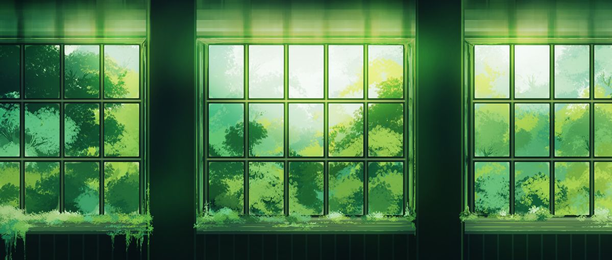
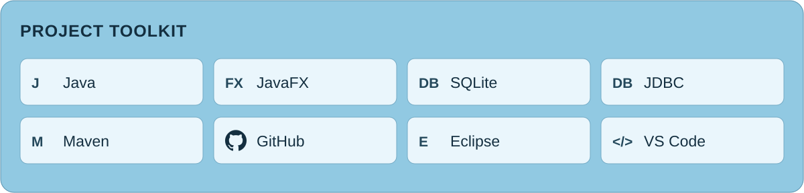

<picture>
  <source media="(max-width:640px)" srcset="assets/hero-mobile.svg">
  
</picture>

Computer Science undergraduate at Brunel University of London and aspiring software engineer. I build with Java and JavaFX, with interests in AI, cloud computing and backend development.

[Connect on LinkedIn](https://www.linkedin.com/in/rf-sunan/)

### Project toolkit

<picture>
  <source media="(max-width:640px)" srcset="assets/tech-stack-mobile.svg">
  
</picture>

### Selected work

#### [Pixel Pocket — Customer Module](https://github.com/RFSUNAN/pixel-pocket-customer)

**University group project · Customer module completed (2025–26).**

Developed registration, login, profile, preference and order-history screens using JavaFX and FXML. Used SQLite and JDBC for customer data and integrated my module with the wider team application.

#### Startup 2 — Neurodivergent Employee Support Platform

**University group project · Ongoing (2026–27).**

Contributed to the Value Propositions and Buy-in and Support sections of the Mission Model Canvas. Responsible for the “View bookings” screen design, with layout implementation and session filters in progress.

### Education & placement

BSc (Hons) Computer Science with Work Placement, Brunel University of London — expected graduation June 2029. Seeking a 2027 industrial placement.

<picture>
  <source media="(max-width:640px)" srcset="assets/footer-mobile.svg">
  
</picture>

[Connect on LinkedIn](https://www.linkedin.com/in/rf-sunan/)

